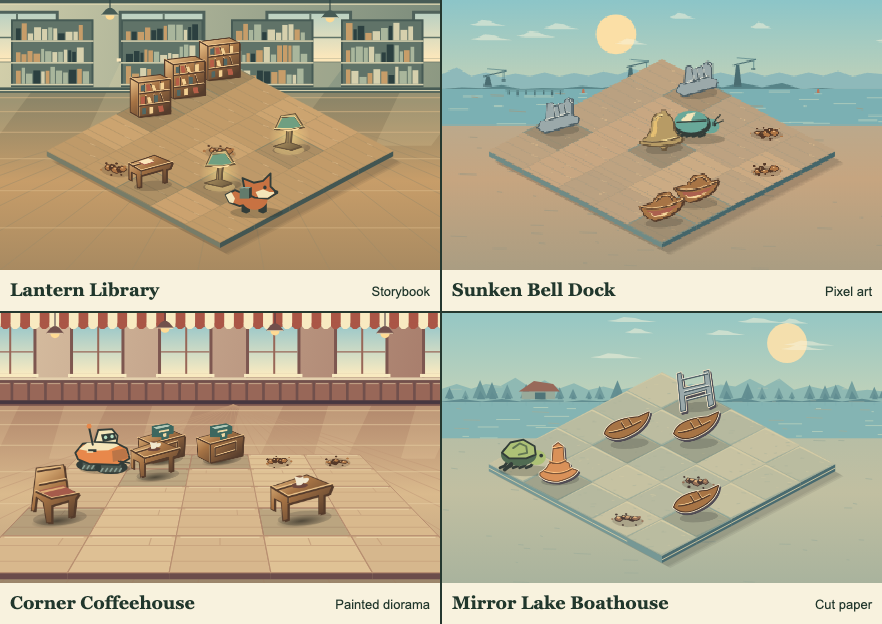
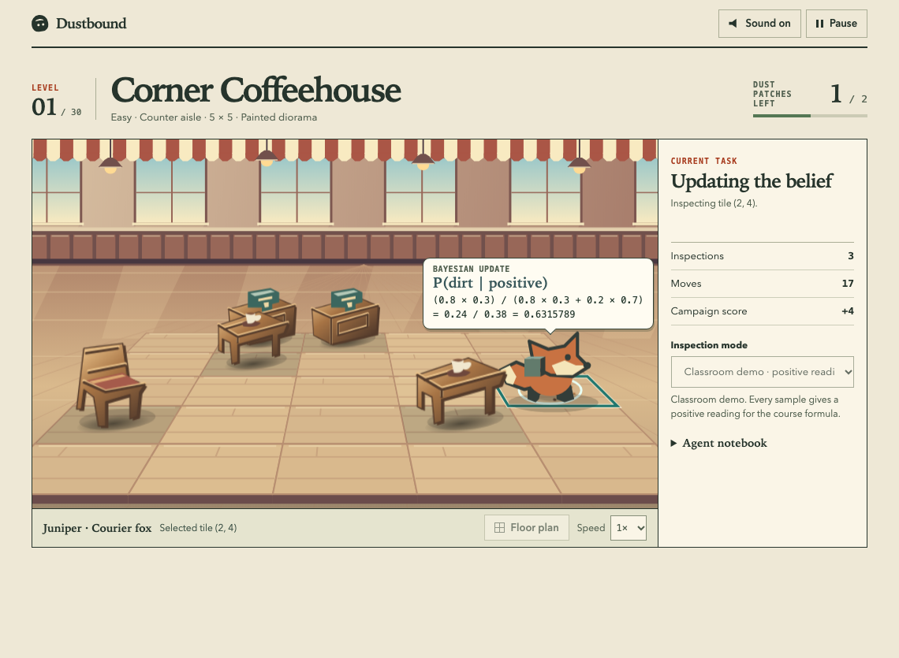
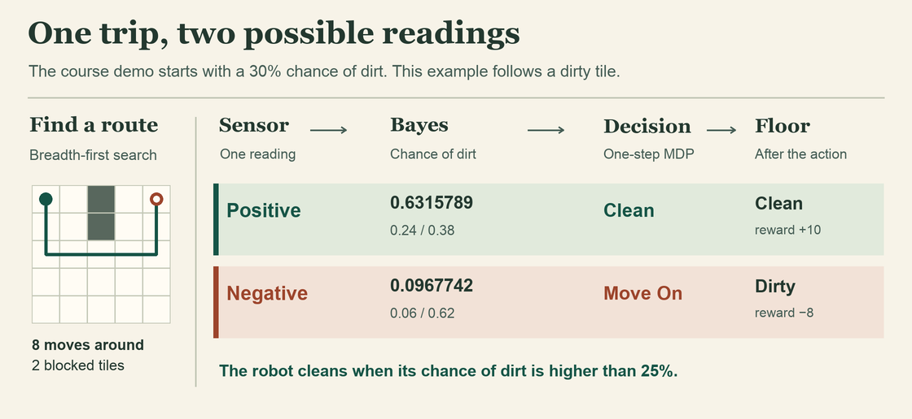
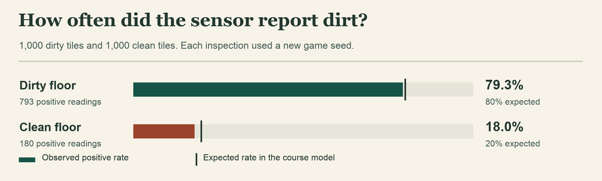

# Dustbound — Mini Robot Vacuum

Point to a tile and watch a small cleaner decide what to do. It finds a route around the furniture, checks the floor and shows its reasoning in a speech bubble. The last patch of dirt opens the next level.



**Play offline.** Download `Dustbound.html` and double-click it. On the GitHub file page, use **Download raw file**. The game includes its art and sound and runs in a browser. [Get the game file](Dustbound.html) · [Watch a 2 min 17 s walkthrough](demo/Dustbound_Showcase.mp4)

## Play the campaign

1. Select a cleaner, a starting location and a board size. A named cleaner stays with you. **Random each level** picks a new cleaner between levels.
2. Click a dirt patch or a piece of bare floor. Your click sets the destination. Every patch is already on the map when the level starts.
3. Watch the speech bubble. The robot shows the sensor reading, the chance of dirt and its choice. **✓ Clean** removes a real patch. **✕ Move On** leaves the floor as it was.
4. Clear all the dirt to move on. On a large board, **Floor plan** shows where the last patches are. **Pause** stops the run at any point.

There are 30 levels, 158 illustrated locations and five board sizes, from 5 × 5 to 100 × 100. Each level asks for one more patch than the previous level, up to the amount of free floor. In the menu you can set the board size once or let it change with each level.



## How the robot decides

The university demo uses one target and two walls on a 5 × 5 floor. A click sets the target in the campaign. The same three methods then work together.

| Method | What it does |
|---|---|
| Breadth-first search (BFS) | Finds a shortest path through open tiles. In the course demo the two walls force an eight-move trip. |
| Bayes’ rule | Uses the sensor reading to update the chance that the target is dirty. |
| One-step Markov decision process (MDP) | Calculates the expected reward for **Clean** and **Move On**. The robot takes the action with the higher value. |



The campaign starts in **Verified inspection** mode. It always finds a real patch and gives a negative reading on bare floor. **Noisy course sensor** uses the university model. Its starting chance of dirt is 30%, its chance of detecting dirt is 80%, and its chance of a false alarm on clean floor is 20%.

| Course reading | Chance of dirt after the reading | Expected reward for Clean | Expected reward for Move On | Choice |
|---|---:|---:|---:|---|
| Positive | 0.24 / 0.38 = **0.6315789** | +4.8421 | −4.3158 | Clean |
| Negative | 0.06 / 0.62 = **0.0967742** | −2.6452 | +1.0323 | Move On |

The reward depends on the real floor. On a dirty tile, cleaning earns +10 and leaving it earns −8. On a clean tile, cleaning earns −4 and leaving it earns +2. The robot chooses Clean above a 25% chance of dirt. On a noisy miss, a patch stays visible. You can inspect it again.

## Run the university demo

Use Python 3.11 or later. In the project folder on macOS or Linux, run the following commands.

```bash
python3 -m venv .venv
source .venv/bin/activate
python -m pip install -r requirements.txt
python -m streamlit run app.py
```

Open the local address printed by Streamlit and select **Open the course demo · 5 × 5**. In the **Positive / Dirty** scenario, press **Step** once to plan, then eight times to move. Press **Scan** to see the calculation and **Decide** to see the action and reward. Select **Negative**, press **Reset**, and repeat to compare the two outcomes.

## What the tests showed

**63 automated tests passed** in the latest recorded run. The 38 Python tests checked the course calculations, the route and complete Streamlit episodes. The 25 Node tests covered the browser game logic, map layouts, level changes and sensor behavior.

One test ran **2,000 inspections** with the noisy course sensor. Each used a fresh game and a fixed seed. The sensor detected dirt on **793 of 1,000 dirty tiles**. It raised a false alarm on **180 of 1,000 clean tiles**. These are counts from the simulator.



| Check | Recorded result |
|---|---|
| Click bare floor | The robot arrives, reports a clean tile in verified mode and leaves all dirt in place. |
| Miss the last patch | The level stays open. A successful repeat inspection removes the patch and opens the next level. |
| Check every floor plan | All walkable tiles were connected in 158 places at five sizes, or 790 combinations. |
| Finish a campaign | The test completed all 30 levels at each fixed size and with the random-size option. |

To repeat the tests, install the Python requirements and use Node.js with its built-in test runner.

```bash
python -m pytest -q
node --test tests/*.test.js
```

[Full verification notes](docs/verification.md) · [Python results](docs/test-results.xml) · [Node results](docs/node-test-results.tap)

## Website

The website opens the campaign at the home page. Choose **Open the 5 × 5 course lab** in the menu to run the fixed experiment. The report, eight slides and the demo video also open from the menu. The offline lab is available as [game/lab.html](game/lab.html).

For a local preview, build and serve the site from the project folder:

```sh
node scripts/build-site.mjs
python3 -m http.server 8000 --directory dist
```

Open `http://localhost:8000/`. On Vercel, import the repository at its root. The included configuration uses the same build and serves the `dist` folder.

## Project materials

| Material | Open |
|---|---|
| Technical report | [PDF](docs/technical_report.pdf) · [Editable Word file](docs/technical_report.docx) |
| Eight-slide presentation | [PowerPoint](presentation/Mini_Robot_Vacuum.pptx) · [PDF](presentation/Mini_Robot_Vacuum.pdf) · [Slide text](presentation/slide_text.md) |
| Defense and demo | [Speaking notes and Q&A](docs/defense_and_qa.md) · [Video script](demo/video_script.md) |
| Team and tools | [Team contribution statement](docs/team_contributions.md) · [AI usage declaration](docs/ai_usage.md) |
| Code | [Python course model](src/) · [Browser game](game/) · [Tests](tests/) |

The Python lab models one inspection at a time. The browser campaign repeats that process on many tiles. Both run on a simulated floor. The probabilities and rewards are teaching assumptions.
