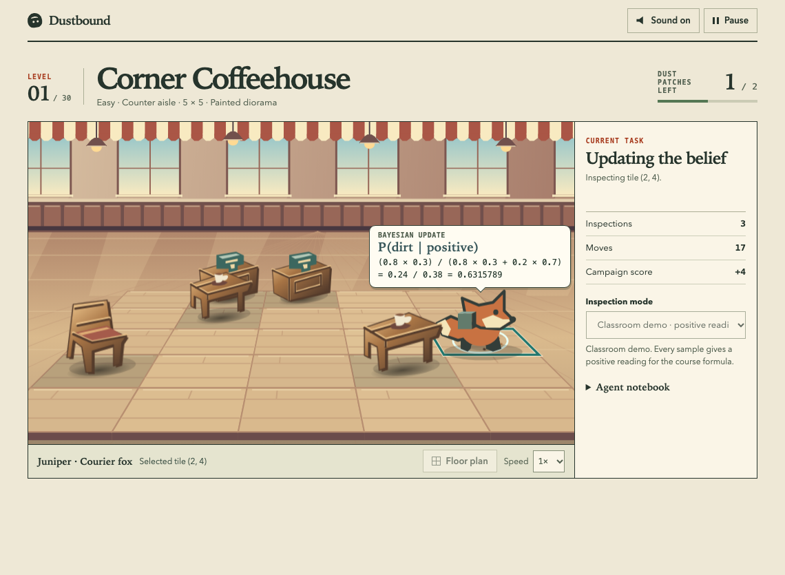

# Mini Robot Vacuum

Technical report · Intelligent Cleaning Agent · Topic 19  
Team roster: Ernur, Sanzhar, Tahirkhan and Adilet

## The course experiment

A robot reaches a tile, reads a dirt sensor and decides whether to clean. Three algorithms share one task. Breadth-first search (BFS) finds a route to the tile. Bayes’ rule turns the sensor reading into a chance of dirt. A one-step Markov decision process (MDP) uses that chance to choose the action with the higher expected reward.

The Python course demo has a 5 × 5 room, two walls and one target. Coordinates start at zero. The robot starts at (0, 0). Its target is (0, 4). Each move goes up, down, left or right and costs one step.

### A route in eight moves

| Row / col | 0 | 1 | 2 | 3 | 4 |
|---|---|---|---|---|---|
| 0 | Start | · | Wall | · | 8 |
| 1 | 1 | · | Wall | · | 7 |
| 2 | 2 | 3 | 4 | 5 | 6 |
| 3 | · | · | · | · | · |
| 4 | · | · | · | · | · |

The numbers show the moves in order. Dots are open floor. The two walls block the crossing in the top two rows. Every route must go down at least twice, move across four columns and go back up twice. This route meets the lower bound of eight moves.

BFS uses a queue to visit nearby tiles first. It remembers the first tile that led to each new one. When it reaches the target, it follows those links back to the start. If the queue runs out before it reaches the target, the robot stops.

### Repeat the run

Start Streamlit and select **Open the course demo · 5 × 5**. Use **Positive** and **Dirty**. Press **Step** once to plan and eight times to move. Press **Scan**, then **Decide**. Use **Negative** and **Reset** to compare the other result.

## From a reading to an action

Before a reading, the model gives the target a 0.30 chance of being dirty. This is its prior. On dirty ground the course sensor gives a positive reading with probability 0.80. On clean ground it still gives a positive reading with probability 0.20.

### Bayes calculations

**Positive reading.** The dirty share is 0.30 × 0.80 = 0.24. The clean share is 0.70 × 0.20 = 0.14. The updated chance of dirt is 0.24 / (0.24 + 0.14) = **0.6315789**.

**Negative reading.** The dirty share is 0.30 × 0.20 = 0.06. The clean share is 0.70 × 0.80 = 0.56. The updated chance of dirt is 0.06 / (0.06 + 0.56) = **0.0967742**.

### Rewards and state changes

| Actual tile | Clean action | Move On action |
|---|---|---|
| Dirty | +10. Tile becomes clean. | −8. Tile stays dirty. |
| Clean | −4. Tile stays clean. | +2. Tile stays clean. |

The model makes one decision at the target. All four state changes in the table have probability 1. Let p be the updated chance of dirt. The expected reward for Clean is 10p − 4(1 − p) = 14p − 4. For Move On it is −8p + 2(1 − p) = 2 − 10p. Clean wins when p > 0.25. At a tie the robot chooses Move On.

| Reading | Updated p | Q(Clean) | Q(Move On) | Choice |
|---|---|---|---|---|
| Positive | 0.6315789 | +4.8421 | −4.3158 | Clean |
| Negative | 0.0967742 | −2.6452 | +1.0323 | Move On |

Q is the expected reward before acting. The simulator scores the action using the actual tile. On a dirty tile with a negative reading, the robot chooses Move On and earns −8. Its choice makes sense given the reading, even though this particular result is costly.

## Cleaning a whole floor

Dustbound is the browser version. It has 30 levels and 158 illustrated places. Players can keep their cleaner and board size or let the game pick new ones for each level. Each place has its own walls and furniture. Sizes range from 5 × 5 to 100 × 100.

The Corner Coffeehouse screen shows the positive classroom calculation. One patch remains. The robot is still calculating the probability, so the patch counter has not changed.

### What a click does

The simulator places all dirt on reachable floor when the level opens. A click sets a destination. The robot follows a shortest route there, reports its reading, shows the probability and chooses an action. Cleaning an actual patch lowers the counter by one. Move On leaves the floor as it was.

The next level opens after the last patch is removed. On a large map, **Floor plan** can locate a distant patch by row and column. A missed patch stays selectable. Each new inspection starts again with the teaching prior of 0.30.

### Two sensor settings

**Verified inspection** is the default for play. It has sensitivity 1 and a false-positive rate of 0. A positive reading gives a chance of dirt of 1, and a negative reading gives 0.

**Noisy course sensor** uses the 0.80 and 0.20 rates from the course demo. A separate classroom option can force a reading for a repeatable example. The reward table stays the same in all settings.

## Tests and limits

All 38 Python tests and 25 Node.js tests passed. The release includes their output in test-results.xml and node-test-results.tap. The Python suite covers the course logic and Streamlit controls. The Node.js suite covers the campaign engine, maps and sensor.

| Test | Observed result |
|---|---|
| Fixed room | BFS found an eight-move route around both walls. |
| Course sensor | Positive gave 0.6315789. Negative gave 0.0967742. |
| Decision boundary | At p = 0.25 both rewards were −0.5. Move On won the tie. |
| Empty floor | A click and inspection left the dirt count unchanged. |
| Last patch | A noisy miss kept the level open. A successful retry removed it. |

### A noisy sensor trial

A repeatable game test used 2,000 seeded inspections. Of 1,000 dirty tiles, 793 gave a positive reading and 207 were missed. Of 1,000 clean tiles, 180 gave a false alarm and 820 gave a negative reading. The observed positive rates were 79.3% and 18.0%. The model settings are 80% and 20%. These counts describe the simulator.

### What the model leaves out

The floor stays still and cleaning always succeeds. The model compares only the next action. It leaves out battery use and the future cost of a missed patch. A useful next step would be to keep a belief for each tile and test when another scan is worth the time.

### Implementation and sources

The course code lives in src/bfs.py, src/bayes.py, src/mdp.py and src/simulation.py. The browser game uses game/engine.js. The two project briefs are Final Project.docx and MiniAI_FPTopics(1).docx, Topic 19. Their file hashes are recorded in source_manifest.json.

The user chose the topic and project requirements. OpenAI Codex helped write the code, run automated checks and prepare the report. The AI usage declaration gives the details. The team contribution statement lists the four members and proposed speaking roles. Each member’s completed work still needs individual confirmation.
